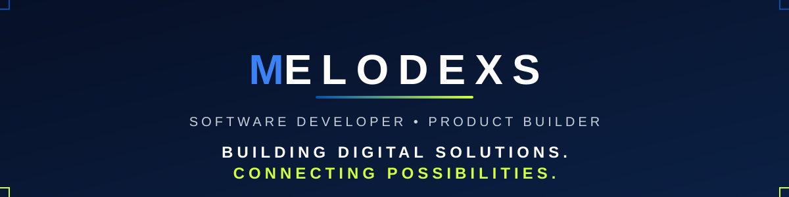
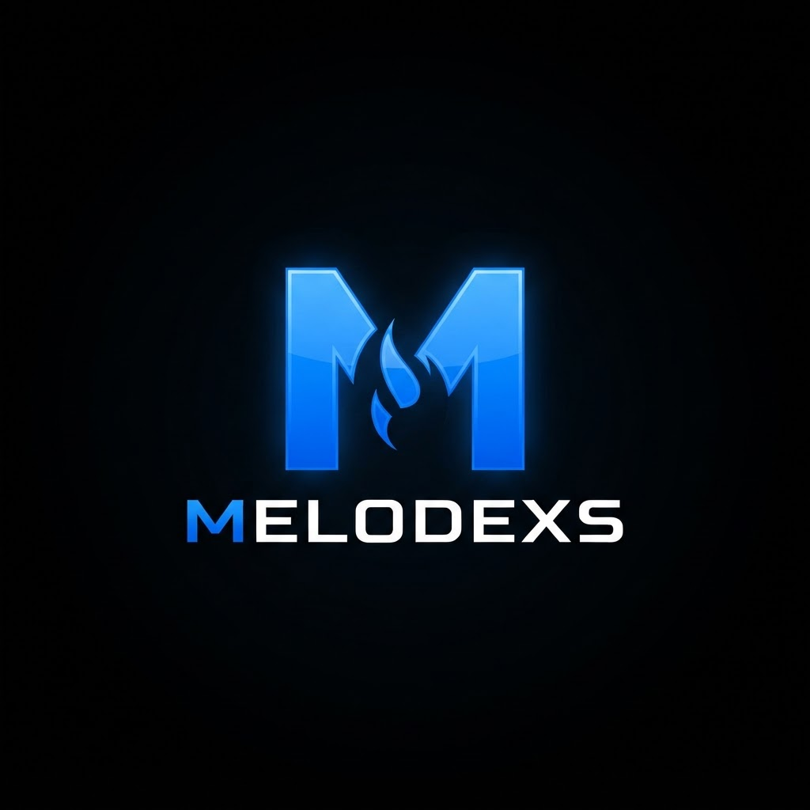

---

## 🚀 Full-Stack Developer • Product Builder

I'm **Okoh Destiny** — a full-stack developer and product builder from Nigeria working across **backend engineering, web platforms, and offline-first mobile apps**.

I take products end to end: designing the data layer, building the API, shipping the interface, and keeping it running in production. Everything I build lives under the **MELODEXS** label.

---

## 🛠️ What I Build

- **Data & Airtime Platforms** — **MELODEXS CONNECT**, a Nigerian platform built to make buying data and airtime accessible, convenient, and affordable
- **Offline-First Mobile Apps** — **MDEXS Flow**, local-first music playback with a SQLite-backed library and a FastAPI backend
- **Practical CLI Tools** — **CampusFlow**, a campus helpdesk ticketing system for raising and tracking support tickets
- **AI Experiments** — retrieval-augmented generation (RAG) chatbot explorations

---

## ⚙️ Technology Toolkit

Verified against the stacks my repositories actually use.

**Languages** 

**Backend** 

**Frontend & Mobile** 

**Tools & Platforms** 

---

## ⚡ Currently Building — MELODEXS CONNECT

### Data. Airtime. Connected.

**Connectivity Within Reach.**

**[MELODEXS CONNECT](https://github.com/melodexs/Melodexs-Connect)** is a Nigerian data and airtime platform designed to make buying connectivity services accessible, convenient, and affordable.

The platform runs live on Render, and the fulfilment backend is being extended toward multi-provider routing — **validation of additional Nigerian data providers is in progress** while the live deployment serves customers today.

 

---

## 📦 Featured Projects

| Project | What it is |
| :--- | :--- |
| **[MELODEXS CONNECT](https://github.com/melodexs/Melodexs-Connect)** | Nigerian data & airtime platform — live on [Render](https://melodexs-connect.onrender.com) FastAPI · React · PostgreSQL · Render |
| **[MDEXS Flow](https://github.com/melodexs/MDEXS-flow)** | Offline-first music player with local audio import and playback React Native · Expo · TypeScript · SQLite · FastAPI |
| **[CampusFlow](https://github.com/melodexs/campus_flow)** | Campus helpdesk ticketing system for raising and tracking tickets Python · CLI · tested storage and validation layer |
| **[joseph-rag-bot](https://github.com/melodexs/joseph-rag-bot)** | Retrieval-augmented generation (RAG) chatbot experiments Python |

---

## 🧭 How I Work

> **Design it. Build it. Test it. Ship it.**

I build products the way they'll need to be maintained: clear data models, tested backends, and interfaces that respect the user. If it works in production, it counts.

---

## 🔭 Current Technical Interests

`Multi-Provider Fulfilment` · `Offline-First Architecture` · `API Design` · `SQLite & PostgreSQL` · `Mobile Audio` · `RAG & LLM APIs` · `Test-Driven Development`

---

## 📊 GitHub Activity

  
  
  

### BUILD • CONNECT • SHIP

MELODEXS · Building digital solutions. Connecting possibilities.

  

© 2026 MELODEXS

