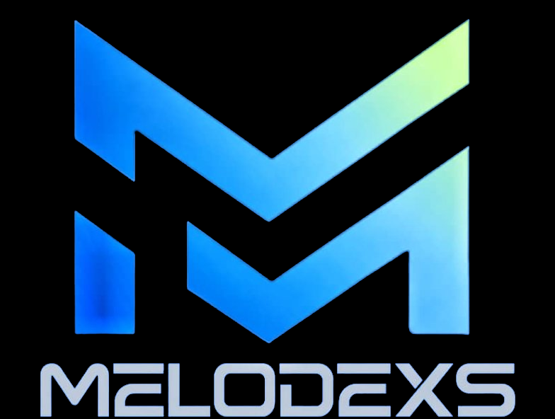
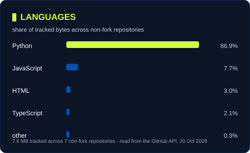
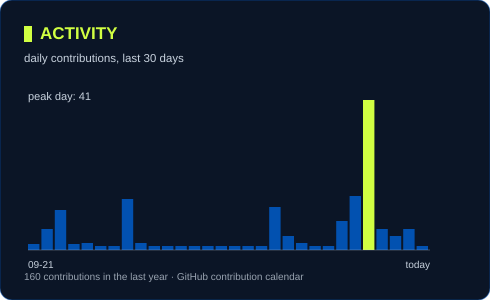
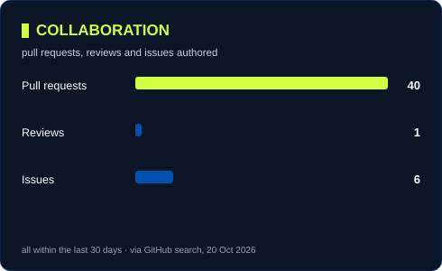
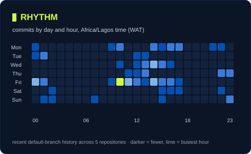
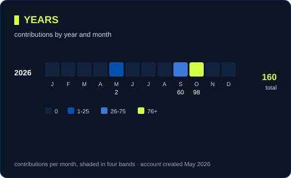
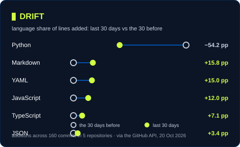

 👋

I'm a developer and graphic designer who brings ideas to life through the power of **design, creative technology, and clean, thoughtful code** that solves real problems.

My focus is on creating things that are **useful, reliable, and enjoyable to use**.

## 🚀 What I'm Into

- Software development
- Graphic design
- Building real-world projects
- Turning ideas into digital experiences
- Learning new technologies

## 🛠️ Tech Stack

### Languages

### Frontend & Mobile

### Backend

### Databases

### Tools

## 📈 Live Activity

## 🌱 Current Focus

I'm currently focused on:

- Modern software development
- Backend development and API integration
- Scalable application architecture
- Building useful digital products
- Continuous learning through project-based work

## 🧩 Featured Projects

### 1. [MELODEXS CONNECT](https://github.com/melodexs/Melodexs-Connect)

A Nigerian data and airtime platform designed to make connectivity services accessible and convenient — **live on [Render](https://melodexs-connect.onrender.com)**, with backend work ongoing to support multiple fulfilment providers.

### 2. [MDEXS Flow](https://github.com/melodexs/MDEXS-flow)

An offline-first music player with local audio import and playback, built around a SQLite-backed library and a FastAPI backend.

### 3. [CampusFlow](https://github.com/melodexs/campus_flow)

A campus helpdesk ticketing system for raising and tracking support tickets, with a tested storage and validation layer.

### 4. [joseph-rag-bot](https://github.com/melodexs/joseph-rag-bot)

Retrieval-augmented generation (RAG) chatbot experiments.

## 🔗 Connect With Me

- GitHub: [melodexs](https://github.com/melodexs)
- LinkedIn: [Add your profile]
- Portfolio: [Add your site]
- Email: okohdestiny882@gmail.com

## ✨ Closing Note

**BUILDING DIGITAL EXPERIENCES.**
**SOLVING REAL PROBLEMS.**
**CONNECTING POSSIBILITIES.**

 

*Always learning. Always building. Thanks for stopping by!* 🚀

© 2026 MELODEXS

